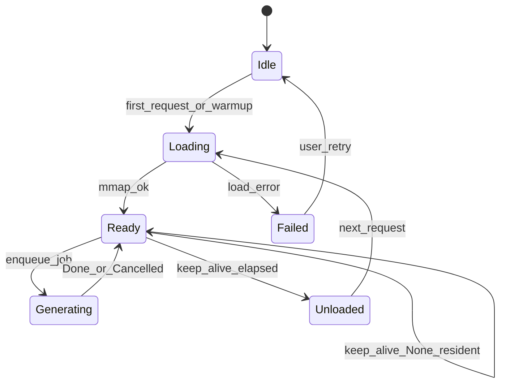
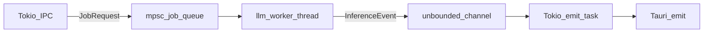

# Moteur IA local — Runa

Inférence 100 % locale via un modèle GGUF quantifié, isolée sur un thread worker dédié. La crate `ai-engine` expose le trait `LocalAiEngine` ; l’implémentation `llama-cpp-2` 0.1.160 est derrière la feature Cargo `llama` (désactivée par défaut ; CMake + toolchain C++ requis pour la compiler). Feature optionnelle `llama-vulkan` pour l’offload GPU.

## 1. Objectifs

- Correction orthographique / reformulation avec **Contexte** (Mail, Chat, Note) et **tons** (Formel, Concis, Fluide).
- Traduction FR ↔ EN / ES / DE avec détection de langue source locale (`whatlang`) avant l’appel.
- Streaming de tokens vers l’UI via canaux Tauri (`InferenceEvent`).
- Empreinte mémoire maîtrisée : Qwen2.5-3B-Instruct Q4_K_M (~2,1 Go), `mmap`, `n_ctx` 2048.

## 2. Cycle de vie du modèle



### Paramètres (`AppConfig::ai`)

| Champ | Rôle | Défaut suggéré |
| --- | --- | --- |
| `model_path` | Chemin absolu du `.gguf` | `{data_dir}/models/Qwen2.5-3B-Instruct-Q4_K_M.gguf` |
| `n_ctx` | Fenêtre de contexte | `2048` |
| `n_gpu_layers` | Couches GPU (−1 = auto) | `-1` |
| `keep_alive_ms` | `None` = résident ; sinon décharge après inactivité | `None` |
| `max_tokens` | Plafond de génération | `512` |
| `temperature_correct` | Échantillonnage correction | `0.3` |
| `temperature_translate` | Échantillonnage traduction | `0.2` |

### Chargement

1. Chargement **paresseux** au premier `correct` / `translate` (ou warm-up optionnel au démarrage).
2. `mmap` du fichier GGUF ; un seul contexte sérialisé sur `llm-worker`.
3. Accélération actuelle : feature optionnelle `llama-vulkan` (Windows / Linux) ; repli CPU SIMD. Metal (macOS) = S6, pas encore exposé en feature Cargo.
4. Feature `llama` absente (défaut Cargo) → `RunaError::Unsupported` sans lier CMake / Vulkan. Les scripts `dev.ps1` / `dev.sh` activent `llama` par défaut (opt-out `-NoLlama` / `--no-llama`).

### Téléchargement initial

- Vérifier présence + hash blake3 du fichier (`shared_utils::DEFAULT_MODEL_BLAKE3`).
- Téléchargement explicite via commande `download_model` (pas de fetch silencieux).
- Progression via événement IPC `model_download` (`ModelDownloadEvent`).
- URL / fichier : Qwen2.5-3B-Instruct Q4_K_M sous `{data_dir}/models/`.

### Keep-alive

- Timer d’inactivité côté worker.
- `keep_alive_ms = None` : modèle résident jusqu’à arrêt de l’app.
- Sinon : drop du contexte / modèle après expiration ; prochain job recharge.

### Annulation

- Chaque job porte un `generation_id` monotone.
- Une nouvelle requête invalide l’id précédent ; le worker lit le jeton entre deux tokens et arrête d’émettre.

## 3. Threading



- Tokio n’appelle jamais les APIs de décodage.
- Un seul job actif à la fois (file d’attente FIFO).
- Les événements : `Started`, `Token { text }`, `Done { full_text }`, `Cancelled`, `Error { RunaError }`.

## 4. Sortie modèle et post-traitement

Le modèle renvoie le **texte final brut** (pas de JSON). Le diff visuel est calculé localement :

1. `LocalAiEngine` produit `full_text`.
2. `shared_utils::text_diff::word_diff(source, full_text)` → `Vec<DiffSpan>`.
3. L’UI affiche les spans (égal / insertion / suppression).

La détection de langue source pour la traduction utilise `whatlang` **avant** l’appel LLM ; le prompt reçoit la langue cible résolue (bascule intelligente FR ↔ EN / ES / DE).

## 5. Prompts système

Les prompts sont centralisés dans `ai-engine` (pas de chaînes dispersées dans l’UI).

### Correction / reformulation

Prompts réels dans `ai-engine::prompts::correction_system(tone, context)` :

```text
Tu es un assistant de rédaction local. Corrige et reformule le texte utilisateur.

Contexte : {context_label}.
{context_rules}

Ton : {tone_label}.
{tone_rules}

Règles communes :
- Conserve la langue source.
- Ne renvoie que le texte corrigé, sans guillemets, sans commentaire, sans markdown.
- Ne change pas le sens ni les faits.
```

Contexte (`WritingContext`) :

| Variante | Consigne courte |
| --- | --- |
| `Mail` | E-mail ; phrases complètes ; pas de jargon chat |
| `Chat` | Slack/Teams/SMS ; court et direct ; pas de « Cordialement » |
| `Note` | Mémo / todo ; listes OK ; pas de formalisme mail |

Tons (`Tone`) :

| Variante | Consigne courte |
| --- | --- |
| `Formal` | Registre professionnel, formulations soignées |
| `Concise` | Phrases courtes, supprimer le superflu |
| `Fluid` | Naturel et fluide à l’oral / message |

### Traduction

```text
Tu es un traducteur local. Traduis le texte vers {target_lang}.
Langue source détectée : {source_lang}.
Règles :
- Ne renvoie que la traduction, sans guillemets, sans commentaire, sans markdown.
- Conserve le ton et les sauts de ligne utiles.
```

Langues supportées (`Language`) : `Fr`, `En`, `Es`, `De`, `Auto` (source uniquement).

## 6. API du trait

```rust
#[async_trait]
pub trait LocalAiEngine: Send + Sync {
    async fn correct(&self, req: CorrectRequest) -> Result<(), RunaError>;
    async fn translate(&self, req: TranslateRequest) -> Result<(), RunaError>;
    async fn cancel(&self) -> Result<(), RunaError>;
    fn subscribe(&self) -> broadcast::Receiver<InferenceEvent>;
}
```

Les requêtes portent le texte source, les options (ton / langues) et le `generation_id` assigné par le host.

## 7. Critères d’acceptation (passe llama / S4)

- [ ] Premier token &lt; 500 ms après warm modèle (GPU) sur machine de référence (manuel, hors CI).
- [x] Annulation interrompt l’émission (test faux backend ; &lt; 100 ms après le token en cours en pratique).
- [x] `keep_alive` décharge le modèle sur le worker (`unload` après `recv_timeout`).
- [x] Aucun JSON parasite dans la sortie affichée (`trim_model_output`).
- [x] Téléchargement explicite + blake3 (pas de fetch au boot).
