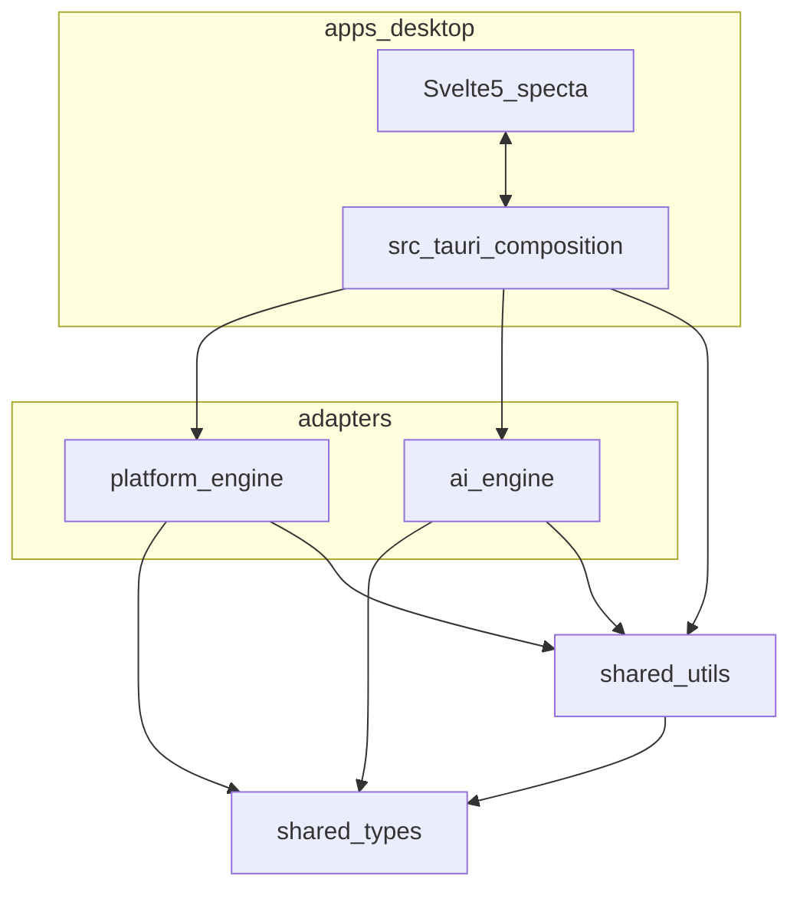
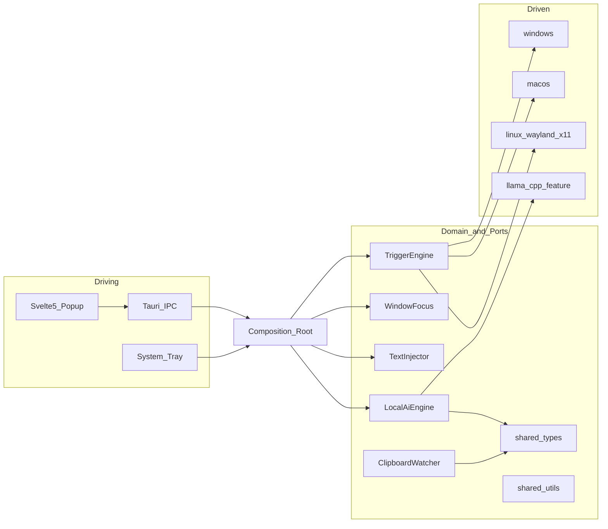
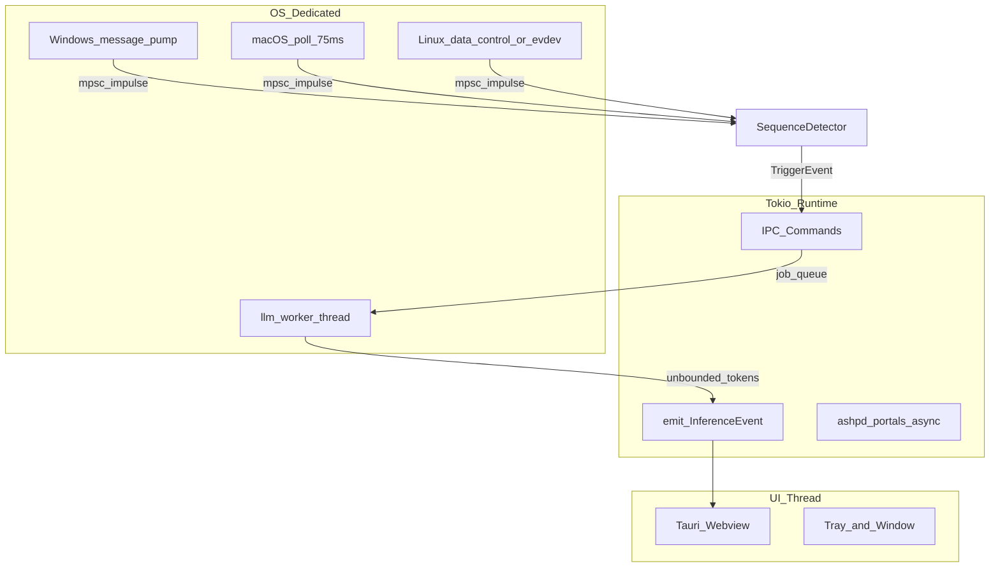

# Architecture Runa

Runa est une application de bureau 100 % locale (concurrent de Reverso) qui s’exécute en daemon (barre système) avec **deux surfaces UI** :
- **Popup rapide** frameless préchargée après un double `Ctrl+C` (`Ctrl+C+C` &lt; 400 ms), idéalement près de la sélection.
- **Fenêtre principale** (clic tray) : saisie libre, correction / reformulation / traduction, copier / coller / remplacer.

Ce document fige l’architecture hexagonale, les flux de données, le modèle de threads et les contrats entre crates.

## 1. Principes

| Principe | Application |
| --- | --- |
| Ports & Adapters | Les OS et le LLM sont derrière des traits ; `apps/desktop/src-tauri` est la seule composition root |
| DRY | Utilitaires uniquement dans `shared-utils` ; types uniquement dans `shared-types` |
| Typage unique | `specta` + `tauri-specta` génèrent les bindings TypeScript ; aucune interface IPC manuelle côté front |
| Erreurs unifiées | `RunaError` (`thiserror` + `specta::Type`) ; pas de `.unwrap()` / `.expect()` hors tests |
| Inversion de dépendances | Traits `ClipboardWatcher`, `WindowFocus`, `TextInjector`, `TriggerEngine`, `LocalAiEngine` |

## 2. Graphe de crates



### Règles de dépendances

1. `shared-types` ne dépend d’aucune crate interne.
2. `shared-utils` peut dépendre de `shared-types` (ex. `DiffSpan`).
3. `platform-engine` et `ai-engine` dépendent de `shared-types` et `shared-utils` ; ils ne dépendent pas de Tauri.
4. Seul `apps/desktop/src-tauri` dépend de Tauri et assemble les adapters.
5. Le frontend ne consomme que les bindings générés (`src/lib/bindings.ts`) et les événements IPC déclarés dans `shared-types`.

## 3. Hexagone (Ports & Adapters)



### Matrice des traits

| Trait | Responsabilité | Implémentations |
| --- | --- | --- |
| `ClipboardWatcher` | Impulsions de changement presse-papiers + lecture texte | Windows / macOS / Linux |
| `WindowFocus` | Capturer et restaurer la fenêtre active (`WindowToken`) | Windows / macOS / Linux |
| `TextInjector` | Simuler Ctrl+V / Cmd+V après restauration du focus | Windows / macOS / Linux (+ repli clipboard) |
| `TriggerEngine` | Orchestrer watcher + `SequenceDetector` (400 ms / 2 hits) | Façade commune + adapters OS |
| `LocalAiEngine` | Charger le GGUF, streamer les tokens, annuler | Worker + backend `llama` (feature) / `Unsupported` |

## 4. Flux Ctrl+C+C → streaming IA

```mermaid
sequenceDiagram
  participant OS as OS_Clipboard_or_Input
  participant Watch as ClipboardWatcher
  participant Seq as SequenceDetector
  participant Focus as WindowFocus
  participant Host as Tauri_Host
  participant Ui as Popup_Svelte
  participant Ai as LocalAiEngine
  participant Worker as llm_worker

  OS->>Watch: impulse_clipboard_or_key
  Watch->>Seq: record_hit
  alt two_hits_under_400ms
    Seq-->>Watch: TriggerFired
    Watch->>Focus: capture_foreground
    Focus-->>Host: WindowToken
    Host->>Ui: show_popup_plus_TriggerEvent_preview
    Note over Watch,Host: Preview = TriggerEvent texte vide ; show() sans attendre le clipboard
    Watch->>Watch: read_clipboard_with_retry
    Host->>Ui: TriggerEvent_hydrated
    Ui->>Host: correct_or_translate
    Host->>Ai: request_stream
    Ai->>Worker: enqueue_job
    loop tokens
      Worker-->>Host: InferenceEvent_Token
      Host-->>Ui: emit_channel
    end
    Worker-->>Host: InferenceEvent_Done
    Ui->>Host: apply_replacement
    Host->>Focus: restore
    Host->>Host: TextInjector_paste
  end
```

Les timings `capture_ms` / `show_ms` / `clipboard_ready_ms` sont des **logs tracing** (sans PII), pas des champs de `TriggerEvent`.

### Contrat de la popup (remplacement en 1 clic)

1. **Avant** `show()` : capturer `WindowToken` (HWND / AXUIElement / PID + wayland surface id selon OS).
2. Afficher la popup en preview (texte vide), hydrater le texte presse-papiers ensuite ; lancer l’inférence une fois le texte non vide.
3. Sur `Entrée` / `apply_replacement` : écrire le texte validé dans le presse-papiers, `hide()` la popup, restaurer le focus, injecter Ctrl+V / Cmd+V.
4. Si l’injection est refusée par l’OS : le texte reste dans le presse-papiers ; l’UI signale le repli (`RunaError::InjectionFallback` ou événement dédié).

## 5. Modèle de threads



Règles strictes :

- Le runtime Tokio **ne décode aucun token** et ne charge pas le GGUF.
- Le modèle a **un seul propriétaire** : le thread `llm-worker` (`std::thread`, hors `spawn_blocking`).
- Une nouvelle requête incrémente un jeton d’annulation lu entre deux tokens.
- Sur Windows, le listener clipboard vit sur un thread avec pompe `GetMessage` et fenêtre message-only.

## 6. Frontend

- Svelte 5 + TypeScript strict + TailwindCSS.
- **Popup** (`label: popup`) : créée au démarrage `visible: false`, **opaque** (`transparent: false`), frameless, always-on-top, skip taskbar → `show()` cible &lt; 50 ms après `Ctrl+C+C`.
- **Fenêtre principale** (S2) : ouverte depuis le tray ; éditable ; chrome custom (`decorations: false`) ; visible dans la barre des tâches (`skipTaskbar: false`).
- Store d’état centralisé consommant les types générés ; aucun `any`.
- Onglets : Correction & Reformulation (diff + tons + axe **Contexte** Mail/Chat/Note) ; Traduction (FR ↔ EN / ES / DE).
- **Exception événements** : les payloads `TriggerEvent` / `InferenceEvent` / `ModelDownloadEvent` sont définis dans `shared-types` ; le front peut les re-déclarer dans `src/lib/events.ts` tant qu’ils ne sont pas exportés via les bindings specta des commandes (pas de duplication des commandes IPC).

### Thème (0.3.1)

- **Source unique** : `apps/desktop/src/theme/tokens.css` définit les variables `--runa-*` (fond, panneau, texte, muted, accent, chip, bordure, insert, delete, danger). Tailwind les expose ; aucun hex / palette utilitaire hors tokens dans les composants.
- **Presets** (persistés dans `UiConfig`) :
  - Mode : `system` | `dark` | `light` (défaut `dark`) — `system` suit `prefers-color-scheme`.
  - Accent : `indigo` | `slate` | `emerald` | `amber`.
  - Densité : `compact` | `comfortable` — la **popup force toujours `compact`** (contrainte 420×360) ; la fenêtre principale suit le choix utilisateur.
- Application : attributs `data-appearance`, `data-accent`, `data-density` sur `<html>`, au chargement des deux webviews via `get_config` / `set_ui_theme`.
- Composants atomiques dans `apps/desktop/src/components` ; `App.svelte` = câblage IPC uniquement.

## 7. Sécurité et localité

- Aucune télémétrie réseau pour l’inférence ; le modèle GGUF est local.
- Le téléchargement initial du modèle est explicite (`download_model`) et vérifié (blake3).
- Sur Linux, le fallback evdev est **opt-in**, filtre Ctrl+C uniquement, sans persistance des frappes.
- **Auto-update (S5)** : le client ne contacte que l’endpoint de release (GitHub Releases / `latest.json`) pour métadonnées et binaires **signés**. Aucun texte utilisateur / presse-papiers n’est envoyé. Voir `docs/COMMANDS.md` § Release et Prompt 13.

## 8. Périmètre actuel

Cette version du dépôt (workspace **1.0.0**) livre :

- Documentation complète (`docs/`) + README install / MAJ.
- Workspace Cargo + traits + types + utilitaires purs.
- Shell Tauri avec commandes IPC qui propagent `RunaError`.
- Thème tokens + presets (S2.1) ; dual UI popup + fenêtre principale.
- Adapters OS Windows / Linux S3-1…4 (macOS stubs jusqu’à S6 ; S3-5 tests manuels ouverts).
- Backend `llama` derrière la feature Cargo `llama` (off par défaut ; CMake requis pour compiler `llama-cpp-2`).
- Axes reformulation `WritingContext` + Ton (BL-014).
- Téléchargement explicite du GGUF + hash blake3 (`download_model`).
- CI PR + pipeline release SemVer + auto-update minisign (S5) ; GGUF hors installeur.

Voir `AI_ENGINE.md` et les sprints dans `docs/product/SPRINTS.md`.
