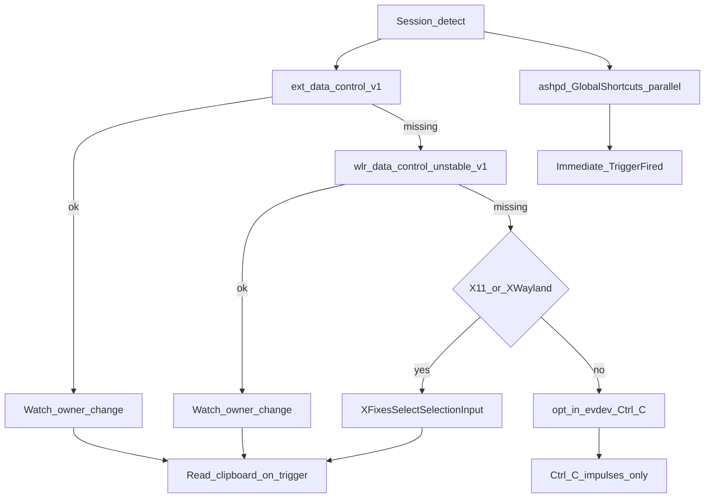

# Compatibilité OS — Runa

Spécifications des APIs natives pour la détection `Ctrl+C+C`, le focus fenêtre et l’injection clavier. Chaque plateforme produit des **impulsions** ; le détecteur de séquence (2 hits / 400 ms) est unique dans `shared-utils::SequenceDetector`.

## 1. Vue d’ensemble

| Plateforme | Détection prioritaire | Fallback | Focus | Injection |
| --- | --- | --- | --- | --- |
| Windows 11 | `AddClipboardFormatListener` + `GetClipboardSequenceNumber` | — | `GetForegroundWindow` / `SetForegroundWindow` | `SendInput` (Ctrl+V) |
| macOS | Polling 75 ms `NSPasteboard.changeCount` | — | AX / NSWorkspace | `CGEvent` (Cmd+V) |
| Fedora 44 Wayland | Chaîne de sondes data-control | XFixes, evdev, GlobalShortcuts | Portail / wlroots | Portail RemoteDesktop ou repli clipboard |

## 2. Windows 11

### Presse-papiers

- Thread dédié avec pompe `GetMessage` / `DispatchMessage`.
- Créer une fenêtre message-only (`HWND_MESSAGE`).
- Appeler `AddClipboardFormatListener(hwnd)`.
- Sur `WM_CLIPBOARDUPDATE` : lire `GetClipboardSequenceNumber()` et émettre une **impulsion** (même si le hash du texte est identique).
- Debounce **40 ms** après une impulsion émise : ignore les notifs suivantes (couvre double `WM_CLIPBOARDUPDATE` et `EmptyClipboard`+`SetClipboardData` d’une même transaction).
- Lire le texte (`OpenClipboard` / `GetClipboardData(CF_UNICODETEXT)`) **uniquement** au déclenchement `TriggerFired`.

### Focus et injection

- Avant `show()` : `GetForegroundWindow()` → `WindowToken::Windows { hwnd }`.
- Remplacement : `hide` popup d’abord (WebView2 tient le FG), puis restore best-effort + `SendInput` Ctrl+V.
- Restauration : `GetAncestor(GA_ROOT)` + `AllowSetForegroundWindow` + timeout FG à 0 + Alt + `AttachThreadInput` / `SetWindowPos` topmost + `SetForegroundWindow` (S2).
- Coller : `SendInput` Ctrl+V via `VK_CONTROL` / `VK_V` (virtuels — AZERTY OK). Échec → `InjectionFallback`, texte déjà dans le presse-papiers.
- Caret (S2) : `GetGUIThreadInfo` + `ClientToScreen(rcCaret)` pour positionner la popup ; sinon centre moniteur.

### Permissions

- Aucune elevation UAC pour le clipboard listener.
- Antivirus / Controlled Folder Access : documenter si le binaire est bloqué.

### Points de friction

- Deux `Ctrl+C` sur le **même** contenu peuvent ne pas incrémenter le sequence number sur certains chemins ; compter les `WM_CLIPBOARDUPDATE` reçues, pas uniquement le delta de numéro.
- Le HWND doit être capturé **avant** l’activation de la popup Runa.

## 3. macOS

### Presse-papiers

- Polling ultra-léger toutes les **75 ms** sur `NSPasteboard.general.changeCount`.
- Chaque incrément = une impulsion vers `SequenceDetector`.
- Lecture du texte (`string(forType: .string)`) **une seule fois** au déclenchement, pour limiter les invites Accès au Presse-papiers (macOS Sequoia+).

### Focus et injection

- Capturer l’application / élément focusé via Accessibility (`AXUIElement`) ou PID de l’app frontmost.
- Restaurer le focus puis synthétiser Cmd+V via `CGEvent`.

### Permissions

- **Accessibilité** (System Settings → Privacy & Security) obligatoire pour focus + injection.
- Accès Presse-papiers : la lecture au déclenchement peut produire une invite ; éviter le polling du contenu.

### Points de friction

- Sans Accessibilité : repli « texte déjà dans le presse-papiers » après hide de la popup.
- AppKit exige que certaines APIs restent sur le thread principal ; le polling peut vivre hors UI tant qu’il ne manipule que `changeCount`.

## 4. Linux — Fedora 44 (Wayland GNOME / KDE)

Un client Wayland non privilégié **ne voit pas** le presse-papiers sous GNOME sans protocole de contrôle. Chaîne de sondes au démarrage :

Le portail `ashpd` GlobalShortcuts est tenté **en parallèle** après la sélection du backend clipboard (pas en chaîne après evdev). Il peut coexister avec data-control / XFixes / evdev.

### Niveau 1 — Data control / XFixes

- `ext-data-control-v1` (protocoles récents) ou `wlr-data-control-unstable-v1` (KDE / compositors wlroots).
- Détecter le **changement d’owner** de la sélection ; ne pas voler en permanence la sélection (évite la course avec le client source).
- Lecture du contenu au moment du trigger uniquement.
- Si session X11 / XWayland : `XFixesSelectSelectionInput` sur `CLIPBOARD`.
- **Implémentation (S3) :** `crates/platform-engine/src/linux/` — sélection pure dans `linux_select.rs` ; thread `lin-clipboard`.

#### GNOME vs KDE (attendu)

| Session | Chemin typique | Notes |
| --- | --- | --- |
| Fedora KDE Wayland | `wlr-data-control` | Owner change → impulsions ; lecture au trigger |
| Fedora GNOME Wayland | souvent **sans** data-control | Si `DISPLAY` (XWayland) → XFixes ; sinon evdev opt-in + portail |
| X11 pur | XFixes | Focus `_NET_*` + XTest Ctrl+V |

### Niveau 2 — Fallbacks

| Mécanisme | Usage | Contraintes |
| --- | --- | --- |
| evdev `/dev/input` | Détecter double Ctrl+C si aucun data-control | Opt-in `linux_evdev_opt_in` ; groupe `input` ; filtre Ctrl+C uniquement ; aucune persistance ; **sans** protocole clipboard la popup s’ouvre mais le texte source n’est pas lisible |
| `ashpd` GlobalShortcuts | Raccourci alternatif configurable (`linux_portal_shortcut`, défaut `CTRL+SHIFT+SPACE`) | **Ne doit pas** être Ctrl+C ; activation = ouverture **immédiate** (pas un 2ᵉ double-tap) ; démarrable **sans** data-control (GNOME Wayland pur) si le bind portail réussit |
| Repli clipboard | Après validation UI | Toujours disponible ; message `InjectionFallback` sous Wayland |

### Focus et injection

- Session X11 pure (`WAYLAND_DISPLAY` absent) : capture PID via `_NET_ACTIVE_WINDOW` / `_NET_WM_PID` ; restore via `_NET_CLIENT_LIST` (repli `_NET_CLIENT_LIST_STACKING`) ; collage XTest Ctrl+V.
- Session Wayland : `WindowToken::Unknown` ou PID XWayland si `DISPLAY` ; **pas** d’injection clavier dans S3 → texte laissé dans le presse-papiers (`InjectionFallback`). RemoteDesktop / libei → BL-011.
- Caret Linux : `None` (popup centrée) → BL-012.

### Permissions et SELinux

- Groupe `input` pour evdev (opt-in).
- Portails XDG Desktop Portal (Flatpak ou session native).
- Si SELinux est en mode bloquant et refuse l’accès aux devices / portails : signaler clairement dans les logs et l’UI (`RunaError::PlatformPermission`).

## 5. Contrat commun `TriggerEngine`

1. Démarrer le watcher OS adapté.
2. Convertir chaque notification en `ClipboardImpulse` (`sequence_hint` optionnel, `immediate`) — **sans** contenu clipboard ni `text_hash`.
3. Passer l’impulsion à `SequenceDetector::record` (seuil 400 ms, 2 hits) sauf si `immediate` (portail → Fired direct).
4. Sur `TriggerFired` : `WindowFocus::capture` **avant** l’émission preview → émettre `TriggerEvent` preview (texte vide) pour `show()` → lire clipboard (retries) → émettre `TriggerEvent` hydraté. Timings `capture_ms` / `show_ms` / `clipboard_ready_ms` = logs uniquement.
5. Arrêt propre : désenregistrer le listener, joindre les threads dédiés.

## 6. Matrice de tests manuels (passe d’implémentation)

- [x] Windows 11 : Ctrl+C+C ouvre la popup avec texte source (S1-4 / S1-5, 2026-10-24).
- [ ] macOS : popup &lt; 50 ms ; Accessibilité refusée → repli clipboard.
- [ ] Fedora GNOME Wayland : data-control absent → fallback documenté.
- [ ] Fedora KDE Wayland : `wlr-data-control` opérationnel.
- [ ] Session X11 : XFixes.
- [ ] Remplacement Entrée : focus restauré + collage.
