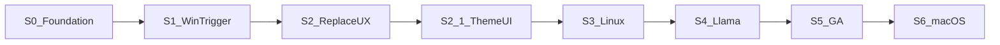

# Sprints — Runa

Cadence suggérée : **1 à 2 semaines** par sprint. Un sprint = une version mineure ou un jalon vers la version suivante.

Mettre à jour le statut (`Todo` / `Doing` / `Done`) à chaque fin de sprint. Les items non tenus retournent au [BACKLOG](./BACKLOG.md) ou au sprint suivant.

## Vue d’ensemble

Ordre produit : **Windows → thème → Linux → IA locale → GA (Win/Linux) → macOS en dernier**.

| Sprint | Version cible | Statut | Focus |
| --- | --- | --- | --- |
| S0 | 0.1.0 | **Done** | Init architecture + docs + stubs |
| S1 | 0.2.0 | **Done** | Trigger Windows + show popup |
| S2 | 0.3.0 | **Done** | Remplacement + UI onglets + fenêtre principale |
| S2.1 | 0.3.1 | **Done** | Thème tokens + UI minimale personnalisable |
| S3 | 0.4.0 | **Doing** | Linux Wayland / fallbacks |
| S4 | 0.5.0 | **Done** | Moteur `llama` + streaming |
| S5 | 1.0.0 | **Done** | CI + installateurs + release auto + MAJ + polish (Win + Linux) |
| S6 | 1.1.0 | Todo | macOS (tests + adapters) — différé |

---

## S0 — Foundation (Done)

**Objectif :** dépôt compilable, règles claires, zéro duplication de types.

- [x] Crates `shared-types`, `shared-utils`, `platform-engine`, `ai-engine`
- [x] App Tauri + Svelte
- [x] Docs techniques
- [x] Scripts dev watch

---

## S1 — Windows Trigger → v0.2.0 (Done)

**Objectif :** double Ctrl+C ouvre la **popup rapide** avec le texte source visible.

| ID | Tâche | Critère d’acceptation |
| --- | --- | --- |
| S1-1 | Impl `WindowsClipboard` | `WM_CLIPBOARDUPDATE` → impulsions |
| S1-2 | Thread message-only | Listener hors UI Tokio |
| S1-3 | Brancher `TriggerEngine.start` au boot | Tray vivant + trigger actif |
| S1-4 | Show popup + `TriggerEvent` | Texte source visible immédiatement **en usage réel** |
| S1-5 | Tests manuels Win11 | Contenu identique / différent OK |

- [x] S1-1 … S1-5 validés (2026-10-24) — double Ctrl+C OK sur Windows

**Surfaces UI (vision produit, détail S2) :**
1. **Popup rapide** — `Ctrl+C+C`, frameless, près de la sélection, actions rapides.
2. **Fenêtre principale** — clic tray / app en arrière-plan : saisie libre, correction / traduction / reformulation, copier / coller / remplacer.

**Hors sprint S1 :** llama (S4), Linux (S3), macOS (S6), fenêtre principale complète, positionnement caret.

---

## S2 — Replace + UX → v0.3.0 (Done)

**Objectif :** Entrée remplace le texte dans l’app d’origine ; UI à deux surfaces (popup + fenêtre principale).

| ID | Tâche | Critère d’acceptation |
| --- | --- | --- |
| S2-1 | `WindowsFocus` + `WindowsInjector` | Restore HWND + SendInput Ctrl+V |
| S2-2 | UI Correction (tons + diff) | Diff affiché après résultat |
| S2-3 | UI Traduction | Bascule FR↔EN/ES/DE |
| S2-4 | Commandes `correct`/`translate` stub→UI | Erreurs `RunaError` visibles |
| S2-5 | Repli injection | Message UI si paste OS refusé |
| S2-6 | Fenêtre principale (tray) | Clic tray ouvre fenêtre éditable (saisie + résultat + copier) |
| S2-7 | Popup près sélection | Position popup au-dessus / près du caret / sélection |

- [x] S2-1 … S2-7 validés (2026-10-24) — replace + dual UI Windows

---

## S2.1 — Thème + UI minimale → v0.3.1 (Done)

**Objectif :** thème unique (tokens CSS) partagé popup + fenêtre principale ; personnalisation sobre (mode / accent / densité) persistée dans `UiConfig` ; UI découpée et épurée.

| ID | Tâche | Critère d’acceptation |
| --- | --- | --- |
| S2.1-1 | Tokens CSS + Tailwind | Toutes les couleurs UI via `--runa-*` ; plus de hex / `zinc-*` / `emerald-*` en dur dans les composants |
| S2.1-2 | Presets mode / accent / densité | `dark` \| `light` \| `system` ; accents indigo/slate/emerald/amber ; densité compact/comfortable |
| S2.1-3 | `UiConfig` + `set_ui_theme` | Persistance TOML ; défauts = look 0.3.0 ; `#[serde(default)]` compatible configs existantes |
| S2.1-4 | Découpe composants | `App.svelte` = câblage ; composants dans `src/components` ; libellés tons en FR |
| S2.1-5 | Menu apparence (main) | Changement mode/accent/densité appliqué aux deux fenêtres ; conservé après redémarrage |
| S2.1-6 | Actions popup | Rangée Copier / Remplacer / Masquer ; Entrée / Échap inchangés |

- [x] S2.1-1 … S2.1-6 validés (2026-10-25) — tokens + presets ; densité branchée sur spacing/fontSize Tailwind

**Hors sprint S2.1 :** couleur libre, polices importées, i18n complète (→ BL-010) ; Linux (S3) ; macOS (S6).

---

## S3 — Linux Fedora Wayland → v0.4.0 (**Doing**)

| ID | Tâche | Critère d’acceptation |
| --- | --- | --- |
| S3-1 | Sonde `ext-data-control` / `wlr-data-control` | Owner change → impulse |
| S3-2 | Fallback XFixes | Session X11 OK |
| S3-3 | evdev opt-in | Config + groupe `input` |
| S3-4 | Portail GlobalShortcuts (alt) | Raccourci ≠ Ctrl+C |
| S3-5 | Injection / repli | Documenté + testé GNOME/KDE |

- [x] S3-1 … S3-4 code en place (2026-10-24) — chaîne select + adapters ; validation manuelle Fedora ouverte
- [ ] S3-5 tests manuels GNOME/KDE (matrice `OS_COMPATIBILITY.md`)

**Hors sprint S3 :** injection RemoteDesktop / libei (→ BL-011) ; caret AT-SPI (→ BL-012) ; clôture 0.4.0 tant que S3-5 non validé.

---

## S4 — Local AI → v0.5.0 (Done)

| ID | Tâche | Critère d’acceptation |
| --- | --- | --- |
| S4-1 | Feature `llama` + `llama-cpp-2` | `cargo check -p ai-engine --features llama` |
| S4-2 | Worker streaming | Tokens → `inference` |
| S4-3 | Prompts + trim sortie | Texte brut, pas de JSON parasite |
| S4-4 | Keep-alive / cancel | VRAM libérée / annulation &lt; 100 ms |
| S4-5 | Download modèle + blake3 | Explicite, pas silencieux |

- [x] S4-1 … S4-5 + clôture 0.5.0 (2026-10-25) — `cargo check --features llama` OK ; inférence réelle Qwen2.5-3B (correction / traduction / cancel) validée sous Windows ; feature Cargo `llama` off par défaut (CMake + MSVC) ; scripts de dev l’activent (`-NoLlama` pour stub)

**Hors sprint S4 :** sélecteur GPU UI (→ BL-005) ; warm-up au démarrage. BL-014 (Contexte + Ton) livré avec 0.5.0.

---

## S5 — GA → v1.0.0 (**Done**)

**Objectif :** produit fini sur **Windows + Linux** (CI, installateurs, pipeline release + versioning auto, auto-update, perf, docs). macOS volontairement hors GA (S6).

| ID | Tâche | Critère d’acceptation |
| --- | --- | --- |
| S5-1 | CI PR (check) | `cargo check` + `cargo test` + `npm run check` sur push/PR (Win + Linux ; feature `llama` optionnelle / job séparé) |
| S5-2 | Bundles installables | `tauri build` → NSIS (Win) + `.deb` et/ou AppImage (Linux) ; install OK machine propre |
| S5-3 | Pipeline release + versioning auto | Job `prepare-version` (bump **mineur** si version dépôt = dernière release) → tag `vX.Y.Z` → build → GitHub Release + artefacts |
| S5-4 | Auto-update | `tauri-plugin-updater` + endpoint release / `latest.json` + signature ; check au démarrage / tray « Vérifier les mises à jour » |
| S5-5 | Perf popup | Cold show &lt; 50 ms mesuré |
| S5-6 | Hardening logs PII | Pas de contenu clipboard en `info` |
| S5-7 | Doc utilisateur + versioning | README install / permissions / MAJ + politique tag/bump dans [`docs/COMMANDS.md`](../COMMANDS.md) |

- [x] S5-1 … S5-7 + clôture 1.0.0 (2026-10-25) — workflows CI/release, `prepare_version.py`, updater minisign + tray, README / COMMANDS ; première GitHub Release via `workflow_dispatch` + secrets `TAURI_SIGNING_*` ; mesure `show_ms` documentée (budget 50 ms)

**Politique de version (S5-3) — résumé :** SemVer ; tag Git `vX.Y.Z` créé par la CI ; si la version du dépôt égale la dernière GitHub Release → bump mineur `X.Y.Z` → `X.(Y+1).0` puis tag + release ; pas de republish d’un même tag. Détail : [`docs/COMMANDS.md`](../COMMANDS.md) § Release.

**Hors sprint S5 :** Authenticode / notarisation (→ BL-015) ; macOS (→ S6) ; GGUF hors installeur (téléchargement explicite inchangé).

---

## S6 — macOS → v1.1.0 (différé)

Reporté après la GA Win/Linux. Stubs macOS restent acceptables jusqu’à ce sprint.

| ID | Tâche | Critère d’acceptation |
| --- | --- | --- |
| S6-1 | Poll `changeCount` 75 ms | Double copie détectée |
| S6-2 | Lecture texte au trigger seulement | Moins d’invites presse-papiers |
| S6-3 | AX focus + Cmd+V | Remplacement si Accessibilité OK |
| S6-4 | UX permissions | Guidage si Accessibilité refusée |
| S6-5 | Bundle macOS | Install + checklist `OS_COMPATIBILITY.md` |

---

## Règles de gestion de sprint

1. **Un objectif principal** par sprint (pas de scope creep).
2. Toute idée nouvelle → [BACKLOG.md](./BACKLOG.md), pas ajout direct au sprint en cours sauf bug bloquant.
3. Fin de sprint : cocher les tâches, bouger le reste, mettre à jour [ROADMAP.md](./ROADMAP.md) et [CHANGELOG.md](./CHANGELOG.md).
4. Respecter `docs/ai/RULES.md` (source unique des règles agents).
